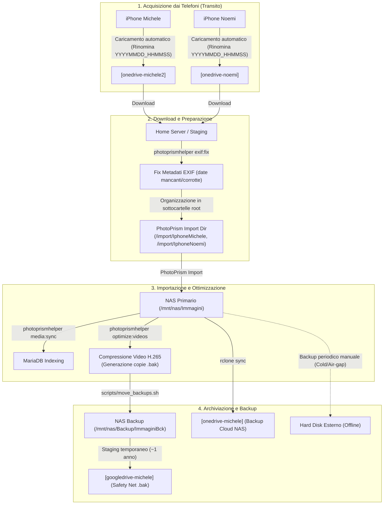

# Architettura e Procedure di Backup Foto & Video

Questo documento descrive l'architettura, la logica di conservazione e la procedura operativa standard (SOP) per il ciclo di vita e il backup delle librerie multimediali personali e familiari gestite tramite **PhotoPrism**, **NAS** e storage cloud (**OneDrive** e **Google Drive**).

---

## 1. Panoramica dei Dischi e Storage Montati

I servizi e gli storage coinvolti sono montati sul server domestico e suddivisi in base al loro ruolo:

| Nome Volume / Remote | Tipo Storage | Ruolo Principale | Percorso Tipico |
| :--- | :--- | :--- | :--- |
| **`[onedrive-noemi]`** | Cloud (OneDrive) | **Transito:** Caricamento automatico foto/video da iPhone Noemi | `/mnt/onedrive-noemi` |
| **`[onedrive-michele2]`** | Cloud (OneDrive) | **Transito:** Caricamento automatico foto/video da iPhone Michele | `/mnt/onedrive-michele2` |
| **`[onedrive-michele]`** | Cloud (OneDrive) | **Disaster Recovery:** Backup cloud speculare della libreria NAS | `/mnt/onedrive-michele` |
| **`[googledrive-michele]`**| Cloud (Google Drive) | **Staging di sicurezza:** Backup temporaneo dei file `.bak` (attivo per ~1 anno) | `/mnt/googledrive-michele` |
| **`NAS Primario`** | Storage Locale / SMB | **Master Library:** Libreria ufficiale PhotoPrism Originals e archivio `.bak` | `/mnt/nas/Immagini`<br>`/mnt/nas/Backup/ImmaginiBck` |
| **`Hard Disk Esterno`** | Disco USB Fisico (Offline) | **Cold Storage / Air-Gap:** Copia fisica offline indipendente collegata periodicamente | Collegato on-demand |

---

## 2. Diagramma del Flusso Operativo



---

## 3. Procedura Operativa Passo-Passo

### Passo 1: Backup dai Telefoni su OneDrive (Transito)
1. **Perché OneDrive:** Il caricamento automatico da app mobile OneDrive viene utilizzato perché:
   - Preserva la qualità e la risoluzione originale dei media senza alcuna compressione o conversione destructiva.
   - Rinomina nativamente i file con il timestamp preciso dello scatto (formato `YYYYMMDD_HHMMSS_*.ext`), fondamentale per la deduzione della data.
2. **Destinazioni dedicate:**
   - **Noemi:** I file vengono caricati su **`[onedrive-noemi]`**.
   - **Michele:** I file vengono caricati su **`[onedrive-michele2]`**.

### Passo 2: Download locale e Correzione Metadati EXIF
1. I nuovi file accumulati su `[onedrive-noemi]` e `[onedrive-michele2]` vengono scaricati nella home directory del server (`~`) o in una directory temporanea di transito.
2. Prima dell'import, viene eseguito il comando CLI di correzione EXIF per popolare i campi di data e ora (`CreateDate`, `DateTimeOriginal`, `ModifyDate`) deducendoli in modo atomico dal nome del file:
   ```bash
   # Anteprima di controllo
   photoprismhelper exif:fix /percorso/transito --dry-run

   # Applicazione effettiva
   photoprismhelper exif:fix /percorso/transito --yes
   ```

### Passo 3: Preparazione nella cartella di Import
I file verificati e corretti vengono spostati nella directory di import di PhotoPrism, mantenendo una cartella radice descrittiva che ne identifichi la provenienza:
- `/percorso/photoprism/import/IphoneMichele/`
- `/percorso/photoprism/import/IphoneNoemi/`

Questo permette a PhotoPrism di mantenere il tracciamento e la catalogazione corretta della sorgente.

### Passo 4: Esecuzione dell'Import su PhotoPrism
1. Viene lanciato il processo di importazione (tramite interfaccia web di PhotoPrism o CLI). PhotoPrism sposta e indicizza i file nella cartella master degli originali (`/mnt/nas/Immagini`).
2. **Aggiornamento Tracking:** A fine import, si aggiorna la tabella in fondo a questo file ([Riquadro Avanzamento](#4-stato-di-avanzamento-tracking)) segnando anno e mese fino al quale il rispettivo telefono è sincronizzato.

### Passo 5: Pulizia Staging e Ottimizzazione Video
1. Eliminare eventuali file temporanei rimasti nella cartella di transito o nella coda di import.
2. Sincronizzare il catalogo e le statistiche sul database ausiliario MariaDB:
   ```bash
   photoprismhelper media:sync
   ```
3. Identificare e ricodificare i video pesanti non compressi (risparmio medio del 50-70% con FFmpeg H.265 preservando tracce audio, metadati e data originale):
   ```bash
   # Identifica i video oltre soglia (es. 100 MB) e genera lo script di ottimizzazione
   photoprismhelper optimize:videos --min-size-mb 100 --generate-script optimize_videos.sh

   # Esecuzione script di ricodifica (crea automaticamente i file di backup originali *.bak)
   bash optimize_videos.sh
   ```

### Passo 6: Spostamento Sicuro dei Backup `.bak` sul NAS
I video originali rinominati in `.bak` non devono rimanere nella cartella degli originali di PhotoPrism per non sprecare spazio nella libreria attiva. Vengono quindi spostati nella directory di backup dedicata sul NAS:
- Percorso destinazione: `/mnt/nas/Backup/ImmaginiBck/`
- Utilizzare lo script dedicato `move_backups.sh` che replica la struttura delle directory, valida dimensione e integrità e cancella l'originale solo a verifica completata:
  ```bash
  # Anteprima dry-run
  ./scripts/move_backups.sh --dry-run /mnt/nas/Immagini /mnt/nas/Backup/ImmaginiBck

  # Spostamento con verifica e conferma
  ./scripts/move_backups.sh -c -y /mnt/nas/Immagini /mnt/nas/Backup/ImmaginiBck
  ```

### Passo 7: Backup Disaster Recovery del NAS su `[onedrive-michele]`
**`[onedrive-michele]`** è la copia cloud remota del NAS per disaster recovery off-site.
Una volta consolidata la libreria sul NAS, si sincronizzano le immagini dal NAS a questo OneDrive tramite `rclone`:
```bash
# Verifica differenze (senza apportare modifiche)
rclone check /mnt/nas/Immagini onedrive-michele:/Nas/Immagini --combined sync-onedrive.txt

# Sincronizzazione effettiva verso OneDrive Michele
rclone sync -P /mnt/nas/Immagini onedrive-michele:/Nas/Immagini --drive-stop-on-upload-limit --user-agent "ISV|rclone.org|rclone/v1.55.1"
```
> [!NOTE]
> **Dettaglio parametri utilizzati:**
> - `-P` (`--progress`): Mostra il trasferimento in tempo reale con velocità, percentuale e tempo stimato.
> - `--drive-stop-on-upload-limit`: Ferma il processo qualora si raggiunga la soglia di limite di caricamento dell'account.
> - `--user-agent "ISV|rclone.org|rclone/v1.55.1"`: Imposta l'identificativo client specifico per ottimizzare le richieste ed evitare throttling API.
> - *(Poiché la configurazione `rclone.conf` è cifrata, ricordare di impostare `export RCLONE_CONFIG_PASS="..."` prima dell'esecuzione se lanciato tramite script).*

*(Se non si desidera eliminare dal cloud i file rimossi dal NAS locale, sostituire `sync` con `copy`).*

### Passo 8: Staging Temporaneo di Sicurezza su `[googledrive-michele]`
I file `.bak` spostati in `Backup/ImmaginiBck/` vengono copiati temporaneamente su **`[googledrive-michele]`**.
- **Scopo:** Poiché questo account Google Drive è disponibile ancora per circa 1 anno, funge da cuscinetto di sicurezza ("safety net").
- Permette di effettuare controlli a campione sui video compressi nel tempo, garantendo che non vi siano state perdite qualitative evidenti o artefatti prima di eliminare definitivamente i file `.bak` pesanti al termine dell'anno.

### Passo 9: Backup Periodico su Hard Disk Esterno (Cold Storage / Air-Gap)
Oltre ai backup online (NAS e Cloud), viene mantenuta una copia fisica offline su un **Hard Disk Esterno USB**.
- **Scopo:** Costituisce la vera protezione anti-ransomware (copia "air-gapped", ovvero fisicamente isolata da rete ed alimentazione per la maggior parte del tempo).
- **Procedura:** Il disco viene collegato periodicamente per sincronizzare la cartella master `/mnt/nas/Immagini` e/o i backup, e viene scollegato e conservato al sicuro non appena terminata la copia.
- **Stato:** L'ultimo allineamento stimato risale ad **Aprile 2025**.

---

## 4. Stato di Avanzamento (Tracking)

Questo riquadro tiene traccia del punto esatto (Anno / Mese) a cui sono allineate le varie fasi della pipeline. **Aggiornare questa tabella ad ogni ciclo di backup completato.**

| Componente / Procedura | Fonte / Destinazione | Anno / Mese Allineato | Note / Stato Attuale |
| :--- | :--- | :---: | :--- |
| **iPhone Michele** | Da telefono $\to$ `[onedrive-michele2]` $\to$ PhotoPrism | `2025 / 06` | In attesa di import per mesi successivi |
| **iPhone Noemi** | Da telefono $\to$ `[onedrive-noemi]` $\to$ PhotoPrism | `2025 / 06` | In attesa di import per mesi successivi |
| **NAS Primario (PhotoPrism)** | Master Library `/mnt/nas/Immagini` | `2025 / 06` | Originals importati e indicizzati |
| **Fix Metadati EXIF** | `photoprismhelper exif:fix` | `2025 / 06` | Date corrette per tutti i file importati |
| **Media Sync (MariaDB)** | `photoprismhelper media:sync` | `2025 / 06` | Database allineato a PhotoPrism |
| **Ottimizzazione Video** | Ricodifica H.265 + Generazione `.bak` | `2024 / 12` | Video fino a fine 2024 compressi |
| **Archiviazione `.bak` su NAS** | Spostamento in `Backup/ImmaginiBck/` | `2024 / 12` | Copie `.bak` spostate fuori dalla libreria attiva |
| **Backup Cloud NAS (`onedrive-michele`)**| Sync NAS $\to$ `onedrive-michele:Nas/Immagini` | `2024 / 12` | `sync-onedrive.txt` generato; 12k file da allineare |
| **Staging `.bak` (`googledrive-michele`)** | Copia `.bak` su Google Drive (1 anno residuo)| `2024 / 12` | File `.bak` in safety-net per verifica a campione |
| **Hard Disk Esterno (Cold Storage)** | NAS $\to$ Disco USB Offline | `2025 / 04` | Ultimo backup stimato ad Aprile 2025; da collegare e aggiornare |

*Ultimo aggiornamento registro:* `2026-10-11`
